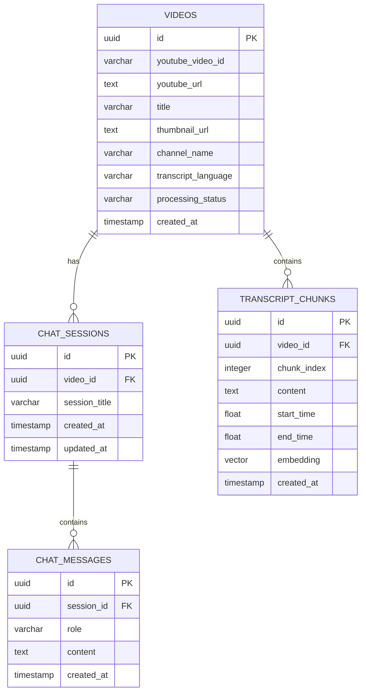

# TubeTalk AI
# Database Design Document

**Project Name:** TubeTalk AI  
**Document Type:** Database Design  
**Version:** 1.0  
**Status:** Proposed  
**Database:** PostgreSQL  
**Platform:** Supabase  
**Vector Extension:** pgvector

---

# 1. Introduction

## 1.1 Purpose

This document defines the database structure required for TubeTalk AI.

It describes:

- Database tables.
- Columns and data types.
- Primary keys.
- Foreign keys.
- Relationships.
- Vector storage.
- Data integrity.
- Retrieval requirements.

## 1.2 Database Objectives

The database must:

1. Store YouTube video information.
2. Store extracted transcript chunks.
3. Store embeddings for semantic retrieval.
4. Maintain independent chat sessions.
5. Store user and AI messages.
6. Preserve conversation history.
7. Prevent information from different videos from mixing.
8. Support future enhancements.

---

# 2. Database Technology

**Database Platform:** Supabase

**Database Engine:** PostgreSQL

**Vector Extension:** pgvector

PostgreSQL will manage structured data, while pgvector will store and retrieve numerical embeddings.

All application data will be stored persistently.

---

# 3. Database Tables Overview

TubeTalk AI will initially use four main tables.

| Table | Purpose |
|---|---|
| videos | Stores YouTube video information |
| chat_sessions | Stores individual chat sessions |
| chat_messages | Stores conversation messages |
| transcript_chunks | Stores processed transcript chunks and embeddings |

## 3.1 Table Relationships

- One video can have multiple chat sessions.
- One video can have multiple transcript chunks.
- One chat session can have multiple messages.
- Every chat session belongs to one video.
- Every transcript chunk belongs to one video.
- Every message belongs to one chat session.

---

# 4. Entity Relationship Diagram



---

# 5. Table 1: videos

## 5.1 Purpose

Stores basic information about every YouTube video submitted to TubeTalk AI.

## 5.2 Schema

| Column | Data Type | Constraints | Description |
|---|---|---|---|
| id | UUID | Primary Key | Unique internal video record ID |
| youtube_video_id | VARCHAR(20) | NOT NULL | YouTube video identifier |
| youtube_url | TEXT | NOT NULL | Original video URL |
| title | TEXT | NULL | Video title |
| thumbnail_url | TEXT | NULL | Thumbnail URL |
| channel_name | TEXT | NULL | Channel name |
| transcript_language | VARCHAR(20) | NULL | Selected transcript language |
| processing_status | VARCHAR(30) | NOT NULL | Current processing status |
| error_message | TEXT | NULL | Processing error details |
| created_at | TIMESTAMPTZ | NOT NULL | Record creation time |
| updated_at | TIMESTAMPTZ | NOT NULL | Last update time |

## 5.3 Processing Status Values

Possible values:

- pending
- processing
- completed
- failed
- transcript_unavailable

## 5.4 Important Rules

- Each YouTube video should have one video record per application user.
- Duplicate submissions should not unnecessarily create duplicate video records.
- Video metadata should be updated when necessary.
- Failed processing should not create incomplete usable transcript data.

For the initial single-user prototype, the application can use one shared video record per YouTube video. If authentication is introduced, user ownership must be added and uniqueness rules updated.

---

# 6. Table 2: chat_sessions

## 6.1 Purpose

Stores independent conversations associated with individual videos.

Each session represents a separate conversation context.

## 6.2 Schema

| Column | Data Type | Constraints | Description |
|---|---|---|---|
| id | UUID | Primary Key | Unique session ID |
| video_id | UUID | Foreign Key | Associated video |
| session_title | TEXT | NULL | Session title |
| created_at | TIMESTAMPTZ | NOT NULL | Session creation time |
| updated_at | TIMESTAMPTZ | NOT NULL | Last activity time |

## 6.3 Important Rules

- Every session must belong to a valid video.
- A video may have multiple sessions.
- Each new video should automatically create a default session.
- Users should be able to reopen previous sessions.
- Session history must remain isolated.

Example:

Video A → Session 1

Video B → Session 2

Video A → Session 3

Session 1 and Session 3 may contain different conversations even though they reference the same video.

---

# 7. Table 3: chat_messages

## 7.1 Purpose

Stores all messages exchanged between the user and the AI assistant.

## 7.2 Schema

| Column | Data Type | Constraints | Description |
|---|---|---|---|
| id | UUID | Primary Key | Unique message ID |
| session_id | UUID | Foreign Key | Associated session |
| role | VARCHAR(20) | NOT NULL | Message sender |
| content | TEXT | NOT NULL | Message content |
| created_at | TIMESTAMPTZ | NOT NULL | Message timestamp |

## 7.3 Role Values

- user
- assistant

## 7.4 Example

| role | content |
|---|---|
| user | What is machine learning? |
| assistant | Machine learning is a branch of AI... |
| user | Explain its applications. |
| assistant | Its applications include healthcare... |

## 7.5 Important Rules

- Every message must belong to a valid session.
- Messages must be retrieved in chronological order.
- User and assistant messages must be distinguishable.
- Conversation history must not be shared between sessions.
- Previous messages should remain available when a session is reopened.

---

# 8. Table 4: transcript_chunks

## 8.1 Purpose

Stores processed transcript segments and their corresponding vector embeddings.

This table is the foundation of the RAG retrieval system.

## 8.2 Schema

| Column | Data Type | Constraints | Description |
|---|---|---|---|
| id | UUID | Primary Key | Unique chunk ID |
| video_id | UUID | Foreign Key | Associated video |
| chunk_index | INTEGER | NOT NULL | Chunk sequence number |
| content | TEXT | NOT NULL | Transcript text |
| start_time | DOUBLE PRECISION | NULL | Starting timestamp in seconds |
| end_time | DOUBLE PRECISION | NULL | Ending timestamp in seconds |
| embedding | VECTOR(384) | NULL | Numerical embedding |
| created_at | TIMESTAMPTZ | NOT NULL | Record creation time |

## 8.3 Why Chunk Index?

The chunk index preserves the original order of transcript segments.

Example:

- Chunk 0
- Chunk 1
- Chunk 2
- Chunk 3

## 8.4 Why Timestamps?

Timestamps allow TubeTalk AI to reference the relevant part of a video.

Example:

AI response:

"The speaker explains supervised learning around 04:35."

The timestamp can be used to generate a YouTube link that starts at the relevant point.

## 8.5 Why VECTOR(384)?

The initial embedding model, all-MiniLM-L6-v2, generates vectors with 384 dimensions.

Therefore, the database column must support the same dimensionality.

The embedding dimension must be updated if the model is changed in the future.

---

# 9. Database Relationships

## 9.1 Videos and Chat Sessions

Relationship: One-to-Many

One video can have multiple chat sessions.

Foreign Key:

chat_sessions.video_id → videos.id

## 9.2 Videos and Transcript Chunks

Relationship: One-to-Many

One video can contain multiple transcript chunks.

Foreign Key:

transcript_chunks.video_id → videos.id

## 9.3 Chat Sessions and Messages

Relationship: One-to-Many

One session can contain multiple messages.

Foreign Key:

chat_messages.session_id → chat_sessions.id

---

# 10. Data Retrieval Rules

The database must enforce logical isolation between videos and sessions.

## 10.1 Video-Specific Retrieval

Whenever a user asks a question, semantic retrieval must filter transcript chunks using the active video ID.

Conceptual SQL:

```sql
SELECT *
FROM transcript_chunks
WHERE video_id = 'ACTIVE_VIDEO_ID'
ORDER BY embedding <=> query_embedding
LIMIT 5;
```

The actual implementation will use parameterized queries and the appropriate pgvector operator.

## 10.2 Session-Specific History

Conversation history must be retrieved using the active session ID.

Conceptual SQL:

```sql
SELECT role, content, created_at
FROM chat_messages
WHERE session_id = 'ACTIVE_SESSION_ID'
ORDER BY created_at ASC;
```

## 10.3 Isolation Requirements

- Never retrieve transcript chunks without the active video filter.
- Never retrieve chat history without the active session filter.
- Never use one video's conversation history for another video's chat.
- Validate that the active session belongs to the requested video.

These rules are critical to preventing cross-video context leakage.

---

# 11. Database Indexing

Indexes will improve retrieval performance as the database grows.

Proposed indexes:

| Table | Column | Purpose |
|---|---|---|
| videos | youtube_video_id | Find videos efficiently |
| chat_sessions | video_id | Find sessions for a video |
| chat_messages | session_id | Retrieve session messages |
| transcript_chunks | video_id | Filter chunks by video |

A vector index may be added to the embedding column after testing the selected distance operator and retrieval strategy.

For a small prototype, exact vector search may be sufficient initially.

---

# 12. Data Integrity and Constraints

The database should enforce:

1. Unique internal IDs.
2. Valid foreign-key relationships.
3. Non-empty message content.
4. Valid message roles.
5. Valid processing statuses.
6. Non-negative chunk indexes.
7. Valid timestamp ranges.
8. Correct embedding dimensions.

Foreign-key deletion behavior should be configured deliberately.

For example, deleting a session may delete its messages, while deleting a video should remove its associated sessions and transcript chunks only when explicitly intended.

---

# 13. Security Considerations

The initial prototype may not include public user authentication.

However, the database design should be prepared for future multi-user support.

Future security requirements:

- User ownership on video records.
- User ownership or validated ownership through sessions.
- Supabase Row Level Security (RLS).
- Backend-side database credentials.
- Restricted access to sensitive operations.
- No exposure of privileged service-role credentials in the frontend.

---

# 14. Future Database Enhancements

Possible future additions:

- users table
- video processing logs
- user preferences
- generated summaries
- saved key takeaways
- feedback and ratings
- transcript source metadata
- multiple transcript languages
- document uploads

These enhancements are outside the initial database implementation unless a requirement makes them necessary.

---

# 15. Conclusion

The TubeTalk AI database will use PostgreSQL with pgvector through Supabase.

The four initial tables will manage video information, transcript chunks, chat sessions, and conversation messages.

The design prioritizes persistent history, video-specific retrieval, session isolation, timestamp preservation, and future extensibility.

**TubeTalk AI — Don't Just Watch. Understand and Interact.**